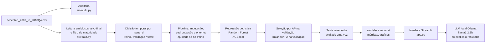

# LendingRisk AI

Sistema acadêmico que estima o risco de um empréstimo terminar como **perda**
(`Charged Off`) a partir de dados históricos do **Lending Club**. Ele combina
pré-processamento, três modelos de Machine Learning e uma **LLM local** (Ollama)
que explica o resultado em português.

> **Uso exclusivamente acadêmico.** O sistema não deve ser usado para aprovar ou
> recusar crédito de verdade.

**Dupla:** Hyan da Cunha Ferreira Inácio (CG3034704) e Luan Ibanhez de Almeida (CG3034755).
**Disciplina:** Ciência de Dados e Sistemas Inteligentes (CARCDSI), TADS, IFSP Caraguatatuba.

## Como funciona



- **Alvo:** `0 = Fully Paid` (quitado) e `1 = Charged Off` (baixado como perda). Ficam
  fora os status sem desfecho final (Current, Late, Default…).
- **Atributos (10), todos conhecidos no momento do pedido:** valor, renda anual, DTI,
  FICO, consultas em 6 meses, uso do rotativo, prazo, finalidade, moradia e tempo de
  emprego. Colunas posteriores à concessão (pagamentos, recuperações, FICO recente) não
  são usadas.
- **A LLM não calcula nada.** Ela recebe a probabilidade, o limiar e a classe vindos do
  classificador e só redige a explicação. Uma verificação automática aponta números
  inventados, classe trocada, texto cortado e atribuição causal.

## Resultados

Os resultados obtidos com o dataset real, e as decisões que levaram a eles, estão em
**[`docs/experimentos.md`](docs/experimentos.md)**. Os números vêm de
`reports/metricas.json` e os gráficos ficam em `reports/figures/`.

**Execução oficial (17/11/2026):** 673.553 empréstimos com prazo encerrado (2007–2015),
14,8% de Charged Off. Divisão temporal: treino até 2015-04, validação de 2015-05 a
2015-08 e teste de 2015-09 a 2015-12.

| Validação | AP | ROC-AUC | Brier |
|---|---:|---:|---:|
| Regressão Logística | 0,2331 | 0,6529 | 0,1218 |
| Random Forest | 0,2323 | 0,6545 | 0,1219 |
| **XGBoost (escolhido)** | **0,2368** | **0,6583** | **0,1214** |

**Teste reservado (XGBoost, limiar 0,09 por F2):**
- AP de **0,2425**, contra 0,148 de um classificador aleatório.
- ROC-AUC de **0,662**.
- Brier de 0,1214, contra 0,1264 de uma previsão constante.
- Recall de **88%** e precision de 18%.

O desempenho é modesto, mas consistente entre validação e teste, e a probabilidade é
bem calibrada (ECE de 1,5 p.p.). O limiar escolhido por F2 sinaliza 73% dos empréstimos
para encontrar 88% dos Charged Off. Por isso a saída serve como triagem para revisão
humana, não como decisão. A análise completa, incluindo subgrupos e limitações, está em
`docs/experimentos.md`.

## Estrutura

```text
lendingrisk-ai/
├── app.py                  # interface Streamlit (proposta ao lado do parecer)
├── .streamlit/config.toml  # tema da interface (cores e fontes; funciona offline)
├── PENDENCIAS.md           # o que ainda falta fazer
├── src/
│   ├── config.py           # atributos, alvo, caminhos, rótulos em português, Ollama
│   ├── download.py         # baixa o dataset e confere o SHA-256
│   ├── audit.py            # auditoria do dataset (sem treinar)
│   ├── data.py             # leitura, limpeza, amostragem, maturidade, divisão temporal
│   ├── evaluation.py       # métricas, limiar F2, calibração, análises por mês/subgrupo
│   ├── figures.py          # gráficos PNG
│   ├── training.py         # treino, seleção, teste único e artefatos
│   ├── inference.py        # validação de artefatos/entradas para a interface
│   ├── pos_teste.py        # análises complementares depois do teste (limiar, v1 x v2)
│   ├── llm.py              # integração com o Ollama + verificação de consistência
│   └── llm_demo.py         # demonstração documentada da LLM (perfis hipotéticos)
├── tests/                  # testes automatizados (dados sintéticos identificados)
├── data/                   # dataset local (não versionado)
├── models/                 # modelo treinado local (não versionado)
├── reports/                # métricas, tabelas, gráficos e logs (versionados)
├── docs/                   # registro de experimentos e roteiros de artigo/pitch
├── requirements.txt        # faixas de versões compatíveis
└── requirements-lock.txt   # versões exatas testadas
```

## Instalação

Requisitos: **Python 3.11 ou 3.12**, Git e cerca de 6 GB livres (dataset + Ollama + modelo).
Versões testadas: Python 3.12.16 no Pop!_OS 22.04, com as bibliotecas de
`requirements-lock.txt`.

### Linux (recomendado: uv)

O [uv](https://docs.astral.sh/uv/) instala o Python 3.12 só para o seu usuário, sem
alterar o Python do sistema e sem `sudo`.

```bash
curl -LsSf https://astral.sh/uv/install.sh | sh     # instala o uv em ~/.local/bin
uv python install 3.12
uv venv --python 3.12 .venv
source .venv/bin/activate
uv pip install -r requirements-lock.txt            # ou: uv pip install -r requirements.txt
```

Alternativa sem uv (precisa do pacote `python3.12-venv` ou equivalente):

```bash
python3.12 -m venv .venv
source .venv/bin/activate
python -m pip install --upgrade pip
python -m pip install -r requirements-lock.txt
```

### Windows (PowerShell)

```powershell
py -3.12 -m venv .venv
.\.venv\Scripts\Activate.ps1
python -m pip install --upgrade pip
python -m pip install -r requirements-lock.txt
```

Se a política do PowerShell bloquear a ativação, use `.\.venv\Scripts\python.exe` no
lugar de `python` nos comandos abaixo. Assim não é preciso alterar políticas do sistema.

## Dataset

```bash
python -m src.download
```

O comando baixa o `accepted_2007_to_2018Q4.csv` (1,68 GB) para `data/`, retoma
downloads interrompidos e **confere o SHA-256**
(`3eae03c28fd9d2e8a076ebeb73507e8d4d0f44d90500decdb0936e0933d1f36a`).

- **Fonte primária:** [Kaggle — wordsforthewise/lending-club](https://www.kaggle.com/datasets/wordsforthewise/lending-club) (licença CC0).
  O Kaggle exige login. Por isso o script usa um espelho público do mesmo arquivo no
  Hugging Face (`codesignal/lending-club-loan-accepted`, CC0, revisão fixa), com o mesmo
  hash de outros dois espelhos independentes.
- **Pelo Kaggle (manual):** baixe o ZIP, extraia **apenas**
  `accepted_2007_to_2018Q4.csv.gz` para `data/` e use esse caminho nos comandos (o
  `.csv.gz` é lido direto). **Não use** o arquivo de pedidos *rejeitados*.
- O dataset nunca é enviado ao GitHub (`data/` está no `.gitignore`).

## Uso

Todos os comandos rodam da raiz do projeto, com o ambiente ativado.

```bash
# 1. Auditoria do dataset (sem treinar; cerca de 30 s)
python -m src.audit --data data/accepted_2007_to_2018Q4.csv

# 2. Treinamento oficial: toda a população elegível, 3 modelos, teste único
python -m src.training --data data/accepted_2007_to_2018Q4.csv

# 2b. Execução rápida para máquinas modestas (amostra de 15%, teto de 150 mil linhas)
python -m src.training --data data/accepted_2007_to_2018Q4.csv --fraction 0.15 --max-rows 150000

# 3. Interface
python -m streamlit run app.py
```

A interface abre em `http://localhost:8501`. Ela tem três abas:
- **Simular empréstimo:** formulário, probabilidade, classe e explicação pela LLM.
- **Desempenho dos modelos:** métricas do teste, comparação na validação e gráficos.
- **Dados e metodologia:** fonte, filtros, partições e limitações.

Opções do treinamento: `--no-maturity-filter` reproduz o comportamento do starter
(sem filtro de maturidade), e `--no-figures` não gera os gráficos.

### Saídas do treinamento

| Arquivo | Conteúdo |
|---|---|
| `models/modelo_risco.joblib` | Pipeline do modelo escolhido (local, não versionado) |
| `reports/metricas.json` | Resumo completo: dataset, SHA-256, partições, comparação, teste, esquema de entrada, versões |
| `reports/comparacao_modelos.csv` | Métricas dos 3 modelos na **validação** |
| `reports/matriz_confusao_teste.csv` | Matriz de confusão no **teste** |
| `reports/importancia_atributos.csv` | Importância **global** por permutação (validação) |
| `reports/calibracao_*.csv`, `curva_limiar_validacao.csv` | Calibração e escolha do limiar |
| `reports/estabilidade_temporal.csv`, `analise_subgrupos_teste.csv` | Estabilidade mensal e subgrupos |
| `reports/historico_execucoes.csv` | Uma linha por execução (rastreabilidade) |
| `reports/figures/*.png` | Gráficos (cada um tem um CSV correspondente) |

### Análises complementares (depois do teste)

Feitas depois de o teste reservado ter sido usado. São descritivas e **não alteram** o
modelo, o limiar nem `reports/metricas.json`. Os detalhes estão na seção 5 de
[`docs/experimentos.md`](docs/experimentos.md).

```bash
# limiares alternativos (definidos na validação) e o efeito de cada um no teste
.venv/bin/python -m src.pos_teste limiar --data data/accepted_2007_to_2018Q4.csv
# variante v2: tempo de emprego "não informado" como categoria própria
.venv/bin/python -m src.training --data data/accepted_2007_to_2018Q4.csv --missing-as-category \
    --model-path models/modelo_v2_ausente_como_categoria.joblib \
    --report-dir reports/analises_pos_teste/v2_ausente_como_categoria
.venv/bin/python -m src.pos_teste comparar   # v1 oficial x v2
```

As saídas ficam em `reports/analises_pos_teste/`. A aba "Desempenho dos modelos" do app
também as mostra.

## LLM local (Ollama)

A explicação usa o modelo `llama3.2:3b` via [Ollama](https://ollama.com/download),
sempre localmente (`127.0.0.1:11434`). Nenhum dado sai do computador. Se o Ollama
estiver desligado, o app continua mostrando a previsão e avisa que a explicação
está indisponível.

**Linux, com sudo** (instalador oficial, que cria um serviço do sistema):

```bash
curl -fsSL https://ollama.com/install.sh | sh
ollama pull llama3.2:3b
```

**Linux, sem sudo** (como foi feito na máquina de desenvolvimento): extraia o pacote
oficial em `~/.local/opt/ollama` e rode como serviço do usuário. Veja
[`docs/ollama_sem_sudo.md`](docs/ollama_sem_sudo.md).

**Windows:** instale pelo [instalador oficial](https://ollama.com/download/windows) e
rode `ollama pull llama3.2:3b` no PowerShell.

Para conferir: `ollama list` deve mostrar `llama3.2:3b`. A barra lateral do app também
mostra o status. Se o serviço já estiver ativo, **não** abra uma segunda instância
com `ollama serve`. Sem GPU dedicada o modelo roda na CPU. Na máquina de
desenvolvimento, cada explicação levou de 15 a 21 s; a primeira chamada leva mais,
porque carrega o modelo.

**Como a explicação é gerada** (`src/llm.py`): o Ollama devolve um JSON com 3 frases
(probabilidade, comparação com o limiar e importância global), e o código monta o
parágrafo. A verificação automática confere os números e a classe. Se encontrar erro
factual, gera uma segunda resposta e fica com a que tiver menos avisos. Os avisos
restantes aparecem na tela.

Para gerar a demonstração documentada com 4 perfis **hipotéticos**:

```bash
.venv/bin/python -m src.llm_demo   # grava reports/llm_demonstracao.{json,md}
```

A evolução do prompt (v1 → v5) e as limitações estão na seção 4 de
[`docs/experimentos.md`](docs/experimentos.md).

Variáveis opcionais: `LENDINGRISK_OLLAMA_URL` (padrão `http://127.0.0.1:11434`) e
`LENDINGRISK_LLM_MODEL` (padrão `llama3.2:3b`).

## Testes

```bash
python -m unittest discover -s tests -v
```

Os testes cobrem:
- leitura, datas e números em vários formatos, status inválidos, amostragem uniforme e
  filtro de maturidade;
- divisão temporal e ausência de vazamento;
- métricas, limiar F2 e calibração;
- treino ponta a ponta, incluindo a prova de que o pré-processamento foi ajustado só no
  treino;
- validação de artefatos corrompidos ou incompatíveis;
- inferência;
- erros do Ollama (com mock) e verificação de consistência da LLM;
- a interface Streamlit (`AppTest`).

Os testes usam **dados sintéticos** (`tests/sintetico.py`), gravados só em pastas
temporárias. Eles verificam o código e **não** produzem resultados científicos.

## Metodologia e limitações (resumo)

- Os empréstimos recentes ainda estavam em andamento. Entre eles, quem já tinha
  desfecho era desproporcionalmente Charged Off (25,1% contra 14,8% nas safras
  encerradas). Por isso, o treino usa apenas empréstimos cujo prazo terminou até
  2018-12 (**filtro de maturidade**). Consequência: validação e teste cobrem 2015 e
  contêm só empréstimos de 36 meses.
- O modelo é escolhido pela **Average Precision (AP)** na validação. O limiar maximiza
  **F2** na validação, priorizando recall e aceitando muitos falsos positivos: sinaliza
  cerca de 73% dos empréstimos. O teste é usado uma única vez. A análise de
  sensibilidade do limiar está na seção 5.1 de `docs/experimentos.md`.
- `grade` e `int_rate` (nota e juros definidos pelo próprio Lending Club) ficam fora do
  modelo por decisão de escopo (seção 5.3).
- A probabilidade é uma estimativa do modelo; a calibração aparece em `reports/` e
  na interface.
- A importância de atributos é **global** e não explica casos individuais. Não há
  explicação causal.
- Os dados são dos EUA (2007–2015 após o filtro) e não representam o mercado brasileiro
  nem o atual.
- Nunca carregue arquivos `.joblib` de fontes não confiáveis: o `joblib` executa código
  ao carregar.

## Reprodutibilidade

- Semente fixa (`SEED = 42`) para amostragem e modelos. O hash do dataset é conferido
  no download e gravado em `metricas.json`.
- `requirements-lock.txt` traz as versões exatas, e `metricas.json["ambiente"]` registra
  as versões usadas no treino. O app avisa se as versões instaladas forem diferentes.
- `reports/historico_execucoes.csv` guarda todas as execuções. As decisões ficam em
  `docs/experimentos.md`.

## Colaboração (Git)

Trabalhe em branches curtas (`feat/...`, `fix/...`, `docs/...`) e abra PRs pequenos
para a `main`. Antes do PR, rode os testes. Nunca versione `data/`, `.venv/` nem
`models/*.joblib`.
