# Guia de estudo do LendingRisk AI

Material para o Luan e o Hyan entenderem o sistema inteiro, do arquivo de dados até a
explicação gerada pela LLM. Todos os números vêm dos arquivos do projeto
(`reports/metricas.json`, `reports/auditoria_dataset.json` e `reports/analises_pos_teste/`).
Nada aqui é estimado ou inventado.

**Como ler:** as partes seguem a ordem em que o sistema funciona. Se o tempo for curto,
leiam primeiro as Partes 1, 3, 4 e 14 (perguntas da banca). Termos técnicos aparecem em
**negrito** na primeira vez e também estão no [glossário](#glossário) no fim.

Cada seção termina com uma linha **No código**, que aponta onde aquilo está implementado.

## Sumário

1. [O problema](#parte-1--o-problema)
2. [Os dados](#parte-2--os-dados)
3. [Como o modelo aprende](#parte-3--como-o-modelo-aprende)
4. [Como medir se o modelo é bom](#parte-4--como-medir-se-o-modelo-é-bom)
5. [As decisões do experimento](#parte-5--as-decisões-do-experimento)
6. [Os resultados, lidos com honestidade](#parte-6--os-resultados-lidos-com-honestidade)
7. [Importância dos atributos](#parte-7--importância-dos-atributos)
8. [Análises feitas depois do teste](#parte-8--análises-feitas-depois-do-teste)
9. [A interface (Streamlit)](#parte-9--a-interface-streamlit)
10. [A LLM local](#parte-10--a-llm-local)
11. [Testes automatizados](#parte-11--testes-automatizados)
12. [Ambiente e reprodutibilidade](#parte-12--ambiente-e-reprodutibilidade)
13. [Mapa do código](#parte-13--mapa-do-código)
14. [Preparação para a apresentação](#parte-14--preparação-para-a-apresentação)
15. [Glossário](#glossário)

---

## Parte 1 — O problema

### 1.1 O sistema em uma frase

O LendingRisk AI recebe as características de um pedido de empréstimo e estima a
**probabilidade** de ele terminar como **Charged Off** (perda). Para isso usa o
histórico do Lending Club, e no fim uma LLM que roda no próprio computador explica o
resultado em português.

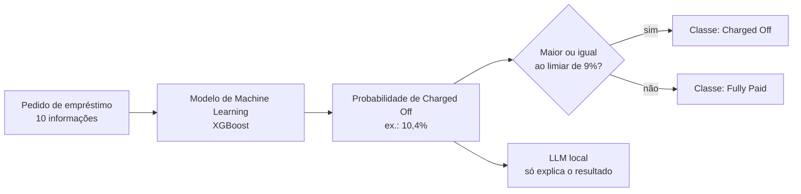

### 1.2 O que é o Lending Club

O Lending Club foi uma plataforma americana de **empréstimo entre pessoas** (*peer-to-peer*,
ou P2P). Uma pessoa pedia dinheiro emprestado e investidores financiavam esse pedido,
sem um banco tradicional no meio. A empresa publicou os dados dos empréstimos aceitos,
e esse arquivo virou um dos conjuntos de dados mais usados para estudar risco de
crédito.

### 1.3 O alvo: Fully Paid ou Charged Off

Todo modelo de **classificação** precisa de um **alvo** (*target*): a resposta que ele
tenta prever. Aqui o alvo é o desfecho do empréstimo:

| Valor | Status | Significado |
|---|---|---|
| 0 | **Fully Paid** | O empréstimo foi quitado. |
| 1 | **Charged Off** | A empresa desistiu de receber e registrou o saldo como perda, em geral depois de um longo período de atraso. |

A classe 1 é chamada de **classe positiva**. "Positivo" não quer dizer "bom". É só a
convenção para o evento que queremos detectar, como num exame médico, em que "positivo"
é ter a doença.

O arquivo também tem empréstimos **sem desfecho final**, que ficam de fora porque ainda
não se sabe como vão terminar:

| Status no arquivo | Linhas | Usado? |
|---|---:|---|
| Fully Paid | 1.076.751 | sim (0) |
| Current (em dia, ainda pagando) | 878.317 | não |
| Charged Off | 268.559 | sim (1) |
| Late 31–120 dias | 21.467 | não |
| In Grace Period | 8.436 | não |
| Late 16–30 dias | 4.349 | não |
| "Does not meet the credit policy" (dois tipos) | 2.749 | não |
| Default | 40 | não |
| vazio | 33 | não |

Sobram **1.345.310** empréstimos com desfecho final.

### 1.4 Por que o problema é difícil

- **Desbalanceamento:** só cerca de **14,8%** dos empréstimos usados são Charged Off.
  Prever o raro é mais difícil, e várias métricas comuns enganam (Parte 4).
- **Pouca informação:** são só 10 informações sobre a pessoa. Muita coisa que causa
  calote acontece **depois** do empréstimo, como perder o emprego ou ficar doente, e
  não aparece nos dados.
- **Mudanças no tempo:** o comportamento de quem pede crédito muda com a economia.
  Por isso o modelo é avaliado em um período **posterior** ao do treino (Parte 3).

O resultado esperado é um modelo **melhor que o acaso, mas longe de perfeito**. É isso
que os números mostram, e saber explicar por quê faz parte do trabalho.

**No código:** `src/config.py` define `TARGET`, `CLASS_MAP` (`Fully Paid` = 0,
`Charged Off` = 1) e os atributos.

---

## Parte 2 — Os dados

### 2.1 O arquivo

- `accepted_2007_to_2018Q4.csv`: empréstimos aceitos de 2007 a 2018.
- **1,68 GB**, **2.260.701 linhas** e **151 colunas**.
- Fica em `data/lending_club/` e **não** vai para o Git (é grande e a redistribuição não é nossa).
- O download (`python -m src.download`) confere o **SHA-256** do arquivo.

> **SHA-256** é uma "impressão digital" do arquivo: um código de 64 caracteres
> calculado a partir de todos os bytes. Se um único byte mudar, o código muda
> completamente. Como o código do nosso arquivo está registrado nas métricas, qualquer
> pessoa consegue provar que usou exatamente o mesmo dataset.

O arquivo é lido em **blocos de 100.000 linhas** para não estourar a memória.

### 2.2 Os 10 atributos

**Atributo** (*feature*) é cada informação de entrada do modelo. Todos foram escolhidos
por serem conhecidos **no momento do pedido**.

| Coluna | Nome na interface | O que é | Mediana no treino |
|---|---|---|---:|
| `loan_amnt` | Valor solicitado | Valor pedido, em dólares | US$ 11.225 |
| `annual_inc` | Renda anual | Renda **anual** declarada, em dólares | US$ 60.320 |
| `dti` | Dívida/renda (DTI) | Dívidas mensais divididas pela renda mensal, em %. DTI de 17% quer dizer que 17% da renda já vai para dívidas | 16,74% |
| `fico_range_low` | Score FICO | Score de crédito americano (300 a 850), parecido com o score da Serasa. Mais alto, melhor histórico | 690 |
| `inq_last_6mths` | Consultas em 6 meses | Quantas vezes o crédito da pessoa foi consultado. Muitas consultas podem indicar alguém buscando crédito em vários lugares | 0 |
| `revol_util` | Uso do rotativo | Quanto do limite de crédito rotativo (cartão, por exemplo) está em uso, em % | 56,5% |
| `term` | Prazo | 36 ou 60 meses | — |
| `purpose` | Finalidade | Para que é o dinheiro (consolidar dívidas, cartão, reforma, negócio…) | — |
| `home_ownership` | Moradia | Aluguel, imóvel financiado (hipoteca) ou próprio | — |
| `emp_length` | Tempo de emprego | De "< 1 ano" a "10 anos ou mais"; 5,0% dos casos não informam | — |

Seis atributos são **numéricos** e quatro são **categóricos** (texto com poucas
opções). Essa diferença importa no pré-processamento (Parte 3).

### 2.3 Vazamento de dados (*data leakage*)

**Vazamento de dados** é usar, no treino, uma informação que não estaria disponível no
momento real da previsão. É como fazer a prova com o gabarito na mesa: a nota fica
ótima, mas não mede nada.

No Lending Club é fácil cair nisso, porque o arquivo tem colunas preenchidas **depois**
da concessão:

| Coluna (exemplos) | Por que seria trapaça |
|---|---|
| `total_pymnt`, `total_rec_prncp` | Quanto a pessoa já pagou: quem pagou tudo, obviamente, não deu calote |
| `recoveries`, `collection_recovery_fee` | Só existem quando houve cobrança de dívida |
| `last_fico_range_low/high` | O FICO **mais recente**: cai quando a pessoa já está atrasando |
| `last_pymnt_d`, `next_pymnt_d` | Datas de pagamento que dependem do desfecho |

Essas colunas estão listadas em `LEAKAGE_COLUMNS`, e a auditoria confere que nenhum dos
10 atributos está nessa lista.

### 2.4 O viés de maturidade (a decisão de dados mais importante)

Esse é o ponto mais sutil do projeto e quase certamente vai aparecer na apresentação.

**O problema.** Imagine avaliar uma turma no meio do semestre olhando só os alunos que
já saíram do curso. Quem saiu cedo ou trancou ou se formou adiantado, e a foto fica
distorcida.

Com empréstimos acontece o mesmo. Um empréstimo de 60 meses emitido em 2017 só termina
em 2022, mas o arquivo vai até dezembro de 2018. Então, entre os empréstimos **recentes**
que já têm desfecho, estão sobretudo os que **terminaram cedo**, e terminar cedo, muitas
vezes, é dar calote.

**A evidência** (`reports/auditoria_dataset.json`):

| Grupo | Empréstimos | Já têm desfecho | Charged Off entre os que têm desfecho |
|---|---:|---:|---:|
| Safras "maduras" (o prazo já terminou) | 676.459 | 99,6% | **14,8%** |
| Safras "imaturas" (o prazo ainda não terminou) | 1.584.209 | 42,4% | **25,1%** |

Sem corrigir isso, a divisão original do projeto teria 18,7% de Charged Off no treino e
24,9% na validação. O modelo seria avaliado num mundo artificialmente pior.

**A correção: o filtro de maturidade.** Só entra o empréstimo cujo prazo **já terminou**
até a última data do arquivo:

```
data de emissão + prazo  ≤  dezembro de 2018
```

**A consequência** (e uma limitação que precisamos assumir):

- sobram **673.553** empréstimos, emitidos de 2007 a 2015;
- empréstimos de 60 meses só entram até cerca de 2013, porque 2013 + 5 anos = 2018;
- por isso **a validação e o teste (2015) só têm empréstimos de 36 meses**, e o
  desempenho do modelo para 60 meses **não foi avaliado**.

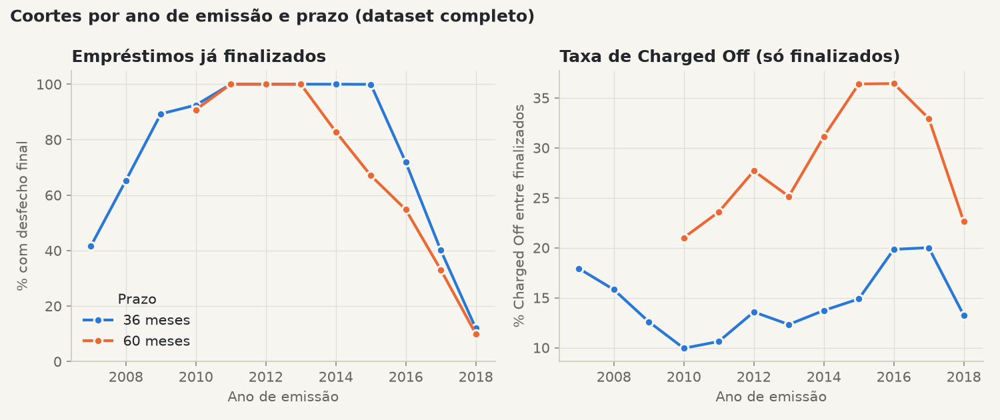

*À esquerda: quanto de cada safra já terminou. Nas safras recentes, a maior parte
ainda estava em andamento. À direita: a taxa de Charged Off entre os que terminaram
sobe artificialmente nas safras recentes.*

### 2.5 Limpeza

- `"36 months"` vira 36; `"45.3%"` vira 45,3; `"n/a"` e vazios viram **ausentes**.
- Datas como `Dec-2015` são convertidas para data de verdade.
- **Amostragem:** o código permite usar só uma fração das linhas, sorteadas com
  probabilidade igual (sorteio de **Bernoulli**). No experimento oficial usamos **100%**
  das linhas elegíveis.

**No código:** `src/data.py` (`load_dataset`, `maturity_mask`, `clean_features`) e
`src/audit.py`.

---

## Parte 3 — Como o modelo aprende

### 3.1 Treino, validação e teste

A melhor analogia é a de uma prova:

| Parte | Analogia | Para que serve | Período | Linhas | Charged Off |
|---|---|---|---|---:|---:|
| **Treino** | Estudar | O modelo aprende os padrões | jun/2007 a abr/2015 | 470.714 | 14,8% |
| **Validação** | Simulado | Escolher o modelo e o limiar | mai a ago/2015 | 95.405 | 14,8% |
| **Teste** | Prova final | Medir o desempenho uma única vez | set a dez/2015 | 107.434 | 14,8% |

Duas regras são essenciais:

1. **A divisão é por tempo, não sorteada.** Na vida real, o modelo aprende com o
   passado e é usado no futuro. Se sorteássemos as linhas, o treino teria empréstimos de
   2015 e o teste de 2010. Seria como "prever" o passado sabendo o futuro, e o resultado
   ficaria otimista demais. Um mesmo mês nunca aparece em duas partes.
2. **O teste é usado uma única vez**, depois de todas as escolhas. Se olhássemos o teste
   para decidir alguma coisa, ele viraria mais um simulado e deixaria de medir o
   desempenho real. Toda análise feita depois disso é marcada como **pós-teste**
   (Parte 8).

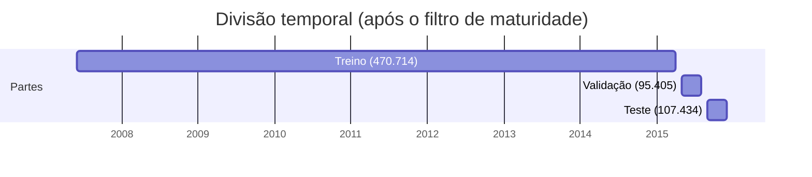

### 3.2 Pré-processamento

Os modelos só entendem números e não aceitam campos vazios, então os dados passam por
uma "linha de montagem" antes de chegar ao modelo:

| Etapa | Atributos | O que faz | Por quê |
|---|---|---|---|
| **Imputação** pela mediana | numéricos | Preenche vazios com a mediana do treino | A mediana não é puxada por valores extremos (rendas milionárias, por exemplo) |
| **Padronização** (*StandardScaler*) | numéricos | Transforma cada valor em "quantos desvios-padrão acima ou abaixo da média" | Coloca renda (milhares) e FICO (centenas) na mesma escala. Importante para a regressão logística; para árvores, não muda nada |
| **Imputação** pela moda | categóricos | Preenche vazios com a categoria mais comum | No oficial, "tempo de emprego vazio" vira "10 anos ou mais". Isso teve consequências (Parte 8) |
| **One-hot encoding** | categóricos | Cria uma coluna 0/1 para cada categoria | Modelos não entendem texto. "Finalidade = cartão" vira `purpose_credit_card = 1` e as outras finalidades = 0 |

O ponto mais importante: **todas essas etapas aprendem os números (mediana, média,
categorias) só com o treino**. Se a média usada na padronização viesse também do teste,
seria vazamento outra vez. O scikit-learn garante isso com o **Pipeline**: um objeto
que encadeia pré-processamento e modelo e só é ajustado (`fit`) com o treino. Há um
teste automatizado que prova isso.

Categorias que nunca apareceram no treino são ignoradas (`handle_unknown="ignore"`) em
vez de quebrar o sistema.

### 3.3 Os três modelos

Comparamos três algoritmos com ideias bem diferentes.

**Regressão logística** — a "linha de base" clássica.

Ela soma os atributos com pesos e passa o resultado por uma curva em forma de "S" (a
**função sigmoide**), que transforma qualquer número numa probabilidade entre 0 e 1:

```
z = peso₀ + peso₁ × FICO + peso₂ × renda + …
probabilidade = 1 / (1 + e^(−z))
```

Funciona como um sistema de pontos: cada característica soma ou subtrai pontos de
risco. É rápida (3,9 s de treino) e fácil de interpretar, mas só capta relações
"lineares", em que mais FICO sempre significa um pouco menos de risco, na mesma
proporção.

**Árvore de decisão** — a base dos outros dois.

É uma sequência de perguntas sim/não: "FICO < 680? Se sim, DTI > 25? …". Uma árvore
sozinha decora os dados de treino com facilidade (**overfitting**, ou sobreajuste): vai
muito bem no treino e mal em dados novos.

**Random Forest** (floresta aleatória) — muitas árvores votando.

Treina **120 árvores**, cada uma com uma amostra sorteada das linhas e, a cada pergunta,
com um sorteio de colunas. A previsão final é a média das árvores. A ideia é que cada
árvore erra de um jeito diferente, e na média os erros se cancelam. Configuração:
profundidade máxima 14 e pelo menos 3 casos por folha. Foi a mais lenta (118,8 s).

**XGBoost** (*eXtreme Gradient Boosting*) — árvores em sequência, cada uma corrigindo a
anterior.

Em vez de árvores independentes, treina **160 árvores pequenas** (profundidade 4), uma
depois da outra. Cada nova árvore foca nos erros das anteriores. A **taxa de
aprendizado** (0,08) faz cada árvore corrigir só um pouco, o que evita exageros.
Também sorteia 85% das linhas e 90% das colunas a cada árvore. Costuma ser o mais forte
em dados de tabela, e treinou em 5,9 s.

> Não houve busca de **hiperparâmetros** (as configurações acima, escolhidas antes do
> treino). É uma limitação declarada e um próximo passo possível.

### 3.4 Probabilidade e limiar

O modelo não responde "sim" ou "não". Ele responde uma **probabilidade**, por exemplo
10,4%. Para virar uma classe, é preciso um **limiar** (*threshold*), uma linha de corte:

- probabilidade **≥ 9%** → Charged Off;
- probabilidade **< 9%** → Fully Paid.

Por que 9%, e não 50%? Porque a escolha do limiar é uma **decisão de negócio**, e não
uma propriedade do modelo (Partes 4 e 5).

**No código:** `src/training.py` (`make_candidates`, `build_pipeline`, `train`).

---

## Parte 4 — Como medir se o modelo é bom

Esta é a parte mais cobrada em apresentações de Machine Learning. Os números são do
**teste** (set a dez/2015, 107.434 empréstimos).

### 4.1 Por que a acurácia engana

**Acurácia** é a porcentagem de acertos. Parece a métrica natural, mas veja:

- um "modelo" que diz **sempre Fully Paid** acerta **85,2%**, porque 85,2% dos
  empréstimos foram quitados, mas **não encontra nenhum** Charged Off;
- o nosso modelo tem acurácia de **38,6%** e encontra **88%** dos Charged Off.

Com classes desbalanceadas, a acurácia premia quem ignora a classe rara. Por isso
usamos outras métricas.

### 4.2 Matriz de confusão

Ela cruza a resposta real com a prevista:

| | Previsto: Fully Paid | Previsto: Charged Off |
|---|---:|---:|
| **Real: Fully Paid** | **27.450** — verdadeiro negativo (VN): bom pagador aprovado | **64.043** — falso positivo (FP): bom pagador barrado (alarme falso) |
| **Real: Charged Off** | **1.905** — falso negativo (FN): mau pagador aprovado (prejuízo) | **14.036** — verdadeiro positivo (VP): mau pagador detectado |

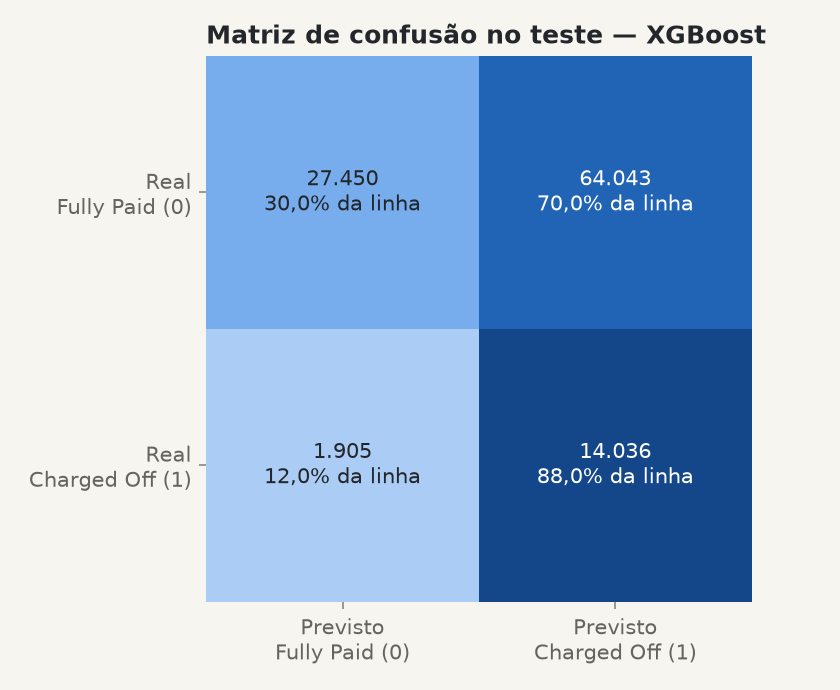

Os dois erros têm custos diferentes. O **falso negativo** gera prejuízo direto (o
dinheiro não volta). O **falso positivo** perde um bom cliente.

### 4.3 Precision, recall, F1 e F2

**Recall** (sensibilidade): dos Charged Off reais, quantos o modelo encontrou?

```
recall = VP / (VP + FN) = 14.036 / (14.036 + 1.905) = 88,0%
```

**Precision** (precisão): dos que o modelo sinalizou, quantos eram mesmo Charged Off?

```
precision = VP / (VP + FP) = 14.036 / (14.036 + 64.043) = 18,0%
```

Existe uma troca entre os dois. Para pegar mais maus pagadores (recall ↑), o modelo
precisa sinalizar mais gente, e com isso erra mais (precision ↓). É como um detector de
metais de aeroporto: se ele apita para qualquer chave, não deixa passar nenhuma arma,
mas para quase todo mundo.

**F1** combina os dois com peso igual (média harmônica). **F2** dá **mais peso ao
recall**. A fórmula geral é o **F-beta**:

```
F_beta = (1 + β²) × precision × recall / (β² × precision + recall)
```

Com β = 2, o recall pesa mais que a precision. Escolhemos o F2 porque, em crédito,
deixar passar um mau pagador foi considerado mais grave que um alarme falso. No teste:
F1 = 0,299 e F2 = 0,495.

### 4.4 Curva precisão × recall e Average Precision (AP)

Cada limiar dá um par (recall, precision). Variando o limiar de 0% a 100%, esses pares
formam a **curva precisão × recall** (PR).

A **Average Precision (AP)** resume essa curva num número só. O ponto de referência é
importante: um modelo que **chuta** tem AP igual à proporção de positivos (**0,148**).
O nosso tem **0,2425**, ou seja, cerca de **1,6 vez** o acaso.

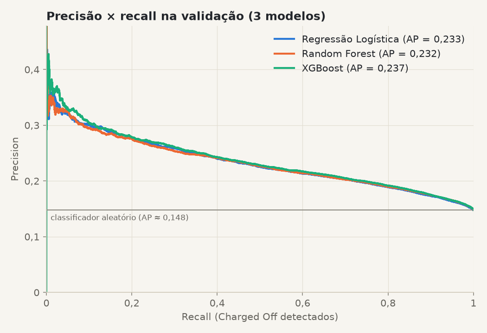

Usamos a AP para **escolher o modelo** porque ela:

- não depende de um limiar específico;
- foca na classe rara (Charged Off), que é o que interessa;
- não se deixa enganar pelo desbalanceamento, como a acurácia.

### 4.5 Curva ROC e ROC-AUC

A **curva ROC** mostra, para cada limiar, a taxa de verdadeiros positivos (recall)
contra a taxa de falsos positivos. A área sob ela, a **ROC-AUC**, tem uma interpretação
bem intuitiva:

> **ROC-AUC = chance de um Charged Off sorteado receber um score maior que um Fully
> Paid sorteado.**

O valor 0,5 é chute e 1,0 é perfeito. O nosso tem **0,662**: em 66% das comparações, o
modelo coloca o mau pagador acima do bom. É uma capacidade **modesta**, coerente com a
pouca informação disponível (Parte 1.4).

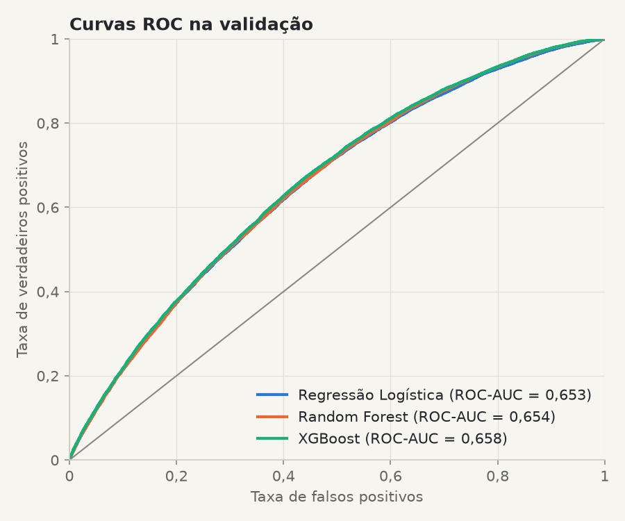

### 4.6 A probabilidade é confiável? Calibração, Brier, log loss e ECE

Além de **ordenar** bem (quem tem mais risco recebe score maior), queremos que a
probabilidade **signifique** alguma coisa. Um modelo é **calibrado** quando, entre os
empréstimos que receberam cerca de 20%, cerca de 20% realmente dão calote.

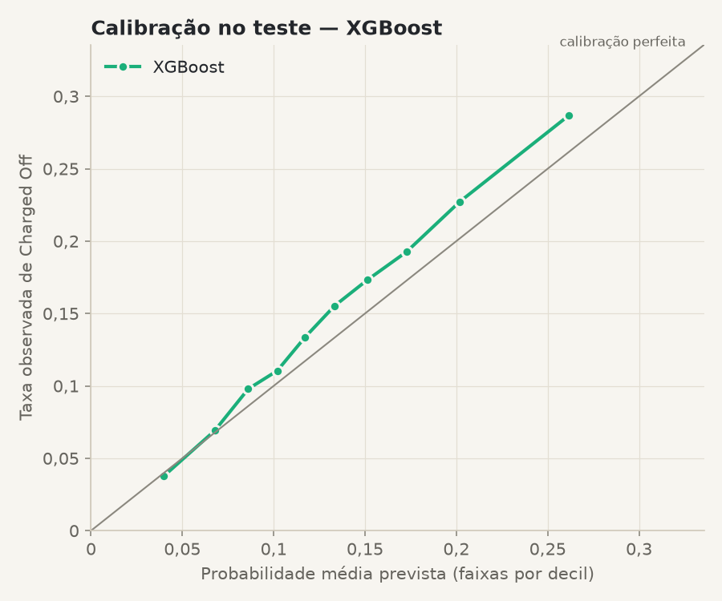

*Cada ponto é um grupo de empréstimos (10 grupos pelo score). Pontos sobre a diagonal
indicam calibração perfeita.*

| Métrica | Nosso modelo | Referência | Leitura |
|---|---:|---:|---|
| **Brier score** (erro quadrático médio da probabilidade; menor é melhor) | 0,1214 | 0,1264 se previsse sempre a taxa média | Melhor que a referência, mas com folga pequena |
| **Log loss** (pune muito quem erra com confiança; menor é melhor) | 0,3994 | — | Usado para comparar modelos |
| **ECE**, erro de calibração esperado (menor é melhor) | **0,0155** | 0 = perfeito | Em média, a probabilidade erra cerca de **1,5 ponto percentual** |

Como calculamos o **ECE**: dividimos os empréstimos em 10 grupos pelo score. Em cada
grupo comparamos a probabilidade média prevista com a taxa real de Charged Off e
fazemos a média dessas diferenças, ponderada pelo tamanho dos grupos.

Um detalhe para a banca: no teste, a probabilidade média prevista foi 13,3%, e a taxa
real foi 14,8%. O modelo subestima um pouco o risco médio daquele período.

### 4.7 Resumo do teste

| Métrica | Valor | Referência trivial |
|---|---:|---:|
| Average Precision | 0,2425 | 0,148 (chute) |
| ROC-AUC | 0,662 | 0,5 (chute) |
| Brier | 0,1214 | 0,1264 (taxa constante) |
| ECE | 0,0155 | — |
| Recall | 88,0% | — |
| Precision | 18,0% | 14,8% (sinalizar todos) |
| Acurácia | 38,6% | 85,2% (dizer sempre Fully Paid) |
| Empréstimos sinalizados | 72,7% | — |

**No código:** `src/evaluation.py` (`scores`, `threshold_curve`, `choose_threshold`,
`calibration_table`, `expected_calibration_error`).

---

## Parte 5 — As decisões do experimento

O **protocolo** (regras do experimento) foi escrito e versionado **antes** do treino
real, em `docs/experimentos.md`, seção 1. Assim ninguém pode dizer que as regras foram
ajustadas para favorecer o resultado.

### 5.1 Escolha do modelo: maior AP na validação

| Modelo | AP (validação) | ROC-AUC (validação) | Tempo de treino |
|---|---:|---:|---:|
| Regressão Logística | 0,2331 | 0,6529 | 3,9 s |
| Random Forest | 0,2323 | 0,6545 | 118,8 s |
| **XGBoost** | **0,2368** | **0,6583** | 5,9 s |

O XGBoost venceu por **pouco**. Os três modelos ficaram muito próximos, o que indica que
o limite está na **informação disponível nos dados**, e não na escolha do algoritmo. É
uma conclusão boa para o artigo.

### 5.2 Escolha do limiar: maior F2 na validação

Testamos todos os limiares de 1% a 99% (de 1 em 1 ponto) na validação e ficamos com o de
maior F2: **9%**. A consequência: o modelo sinaliza **72,7%** dos empréstimos. Nenhuma
financeira recusaria 3 de cada 4 clientes. Por isso fizemos uma análise de
sensibilidade (Parte 8).

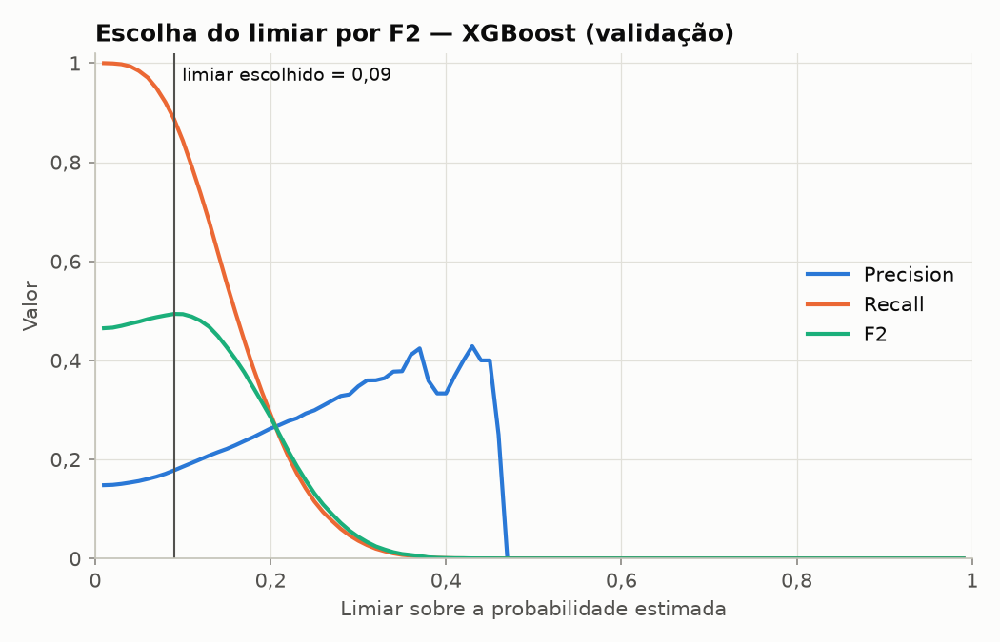

### 5.3 Teste uma vez e reprodutibilidade

- O teste foi calculado uma única vez, com modelo e limiar já escolhidos.
- **Semente aleatória** fixa (42): sorteios repetíveis.
- **SHA-256** do dataset registrado em `reports/metricas.json`.
- Versões exatas das bibliotecas em `requirements-lock.txt`.
- Cada execução é registrada em `reports/historico_execucoes.csv`. O treino oficial foi
  rodado três vezes e deu **as mesmas métricas** nas três, o que mostra que é
  reproduzível.

---

## Parte 6 — Os resultados, lidos com honestidade

**O que está bom:**

- o modelo supera todas as referências triviais (AP 1,6 vez o acaso; Brier melhor que a
  taxa constante);
- a probabilidade é bem calibrada (ECE de 0,0155);
- o desempenho é **estável** mês a mês: no teste, a AP mensal variou entre 0,228 e
  0,255 (`reports/estabilidade_temporal.csv`).

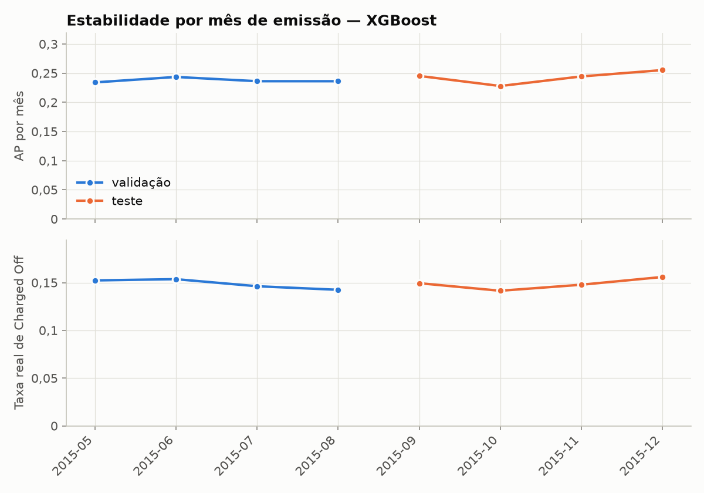

**O que é limitado:**

- a capacidade de separar bons e maus pagadores é modesta (ROC-AUC 0,66);
- com o limiar F2, só 18% dos sinalizados são Charged Off de fato;
- 60 meses não foi avaliado, e os dados são dos EUA de 2007–2015.

**Diferenças entre grupos (análise descritiva, no teste):**

| Moradia | Charged Off real | Bons pagadores barrados (taxa de falso positivo) |
|---|---:|---:|
| Imóvel financiado (MORTGAGE) | 12,0% | 58,6% |
| Próprio (OWN) | 16,1% | 74,2% |
| Aluguel (RENT) | 17,6% | **82,4%** |

Quem paga aluguel tem mais calote real, mas também tem **muito mais** alarmes falsos:
82% dos bons pagadores que alugam seriam barrados. Num sistema real, isso levantaria uma
discussão de **justiça** (*fairness*). Fizemos só a análise descritiva, sem métricas
formais de justiça, e isso é uma limitação declarada.

---

## Parte 7 — Importância dos atributos

### 7.1 Importância por permutação

Para saber quanto o modelo depende de cada atributo, usamos a **importância por
permutação**:

1. medimos a AP do modelo numa amostra de 5.000 empréstimos da validação;
2. **embaralhamos** só uma coluna (por exemplo, o FICO), quebrando a relação dela com o
   resultado;
3. medimos a AP de novo. Quanto mais ela **cai**, mais o modelo dependia daquela coluna;
4. repetimos 5 vezes e tiramos a média.

| Atributo | Queda média na AP |
|---|---:|
| Score FICO | 0,0265 |
| Renda anual | 0,0168 |
| Consultas em 6 meses | 0,0118 |
| Valor solicitado | 0,0113 |
| Finalidade | 0,0083 |
| Dívida/renda (DTI) | 0,0059 |
| Moradia | 0,0058 |
| Prazo | 0,0000 |
| Tempo de emprego | −0,0011 |
| Uso do rotativo | −0,0021 |

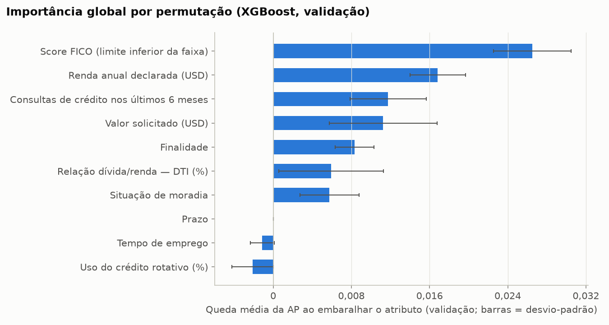

### 7.2 Como ler (e como não ler)

- **Valores perto de zero ou negativos** querem dizer que embaralhar a coluna quase não
  muda nada. O modelo praticamente não usa aquele atributo, e o "negativo" é só ruído.
- **Prazo = 0 não prova que o prazo é irrelevante.** A importância foi medida na
  validação, que só tem empréstimos de 36 meses. Embaralhar uma coluna em que todos os
  valores são iguais não muda nada.
- **É importância global**, isto é, o que o modelo usa **em média**. Ela **não** diz o
  que pesou numa previsão específica. A interface e a LLM repetem esse aviso.
- **Não é causalidade.** "O modelo usa FICO" não quer dizer que "o FICO causa o calote".
  Quer dizer que o FICO ajuda a prever.

**No código:** `src/training.py` (`permutation_importance`); tabela em
`reports/importancia_atributos.csv`.

---

## Parte 8 — Análises feitas depois do teste

Depois de ver o teste, encontramos pontos que mereciam investigação. Para não "ajustar a
resposta depois de ver o gabarito", tudo isso ficou **separado** em
`reports/analises_pos_teste/` e foi declarado como **análise pós-teste**. O modelo e o
limiar oficiais não mudaram. Detalhes na seção 5 de `docs/experimentos.md`.

### 8.1 E se o limiar fosse outro?

Os critérios alternativos foram definidos **só com a validação**. Resultado no teste:

| Critério | Limiar | Sinaliza | Recall | Precision | Charged Off perdidos | Alarmes falsos |
|---|---:|---:|---:|---:|---:|---:|
| **Máximo F2 (oficial)** | 9,0% | 72,7% | 88,0% | 18,0% | 1.905 | 64.043 |
| Máximo F1 | 14,0% | 41,1% | 60,5% | 21,9% | 6.294 | 34.491 |
| Sinalizar 20% de maior risco | 18,9% | 18,7% | 32,8% | 26,0% | 10.718 | 14.833 |

**Lição:** não existe limiar "certo". Mudar o corte só escolhe **qual erro aceitar**. A
precision nunca passa de 26% porque o modelo, com esses dados, separa as classes de forma
limitada.

### 8.2 Versão 2: "tempo de emprego não informado" como categoria própria

**O problema:** no oficial, o campo vazio vira "10 anos ou mais" (a moda). Mas quem não
informa dá **mais** calote: 21,7% real, contra um risco médio previsto de 16,3%. O
próprio silêncio é um sinal de risco.

**A mudança:** na v2, "vazio" vira uma categoria própria (`nao_informado`), e o modelo
aprende o risco dela. Todo o resto seguiu o mesmo protocolo.

| | v1 (oficial) | v2 |
|---|---:|---:|
| AP no teste | 0,2425 | 0,2446 |
| ROC-AUC no teste | 0,6623 | 0,6634 |
| Risco previsto para "não informado" (real: 21,7%) | 16,3% | 19,1% |

A distância caiu pela metade (de 5,3 para 2,6 pontos). A melhora geral é pequena e não
fizemos teste estatístico, então não dá para afirmar que a v2 é "comprovadamente
melhor". O app continua usando a v1.

### 8.3 Por que `grade` e `int_rate` ficaram de fora

São a nota (A a G) e a taxa de juros que o **próprio Lending Club** definia com o modelo
de risco interno dele. Prevêem muito bem o calote, mas:

1. o nosso modelo passaria a **copiar** a avaliação do Lending Club, em vez de estimar
   o risco pelos dados do cliente;
2. um cliente novo, fora do Lending Club, não teria essa nota;
3. os 10 atributos foram definidos pela dupla antes do experimento.

Não é vazamento (essas informações existem na concessão). É uma **decisão de escopo**.

**No código:** `src/pos_teste.py` e a opção `--missing-as-category` de
`src/training.py`.

---

## Parte 9 — A interface (Streamlit)

### 9.1 Como o Streamlit funciona

O **Streamlit** transforma um script Python em página web. A ideia central é que, **a
cada clique, o script inteiro roda de novo**, de cima para baixo. Para não refazer
trabalho caro a cada clique:

- `st.cache_resource` guarda o **modelo** carregado, que é pesado;
- `st.cache_data` guarda as **métricas**. A chave do cache inclui a data de modificação
  do arquivo, então, se o modelo for retreinado, o app recarrega sozinho;
- `st.session_state` guarda o que precisa sobreviver entre cliques, como o último
  resultado e a explicação da LLM.

### 9.2 As três abas

1. **Simular empréstimo** — a proposta (formulário) fica à esquerda e o parecer à
   direita:
   - a **probabilidade** aparece em destaque;
   - o **carimbo** mostra a classe (CHARGED OFF ou FULLY PAID);
   - a **régua de risco** mostra onde a proposta cai: a linha preta é o limiar de 9%, a
     área hachurada é a faixa classificada como Charged Off, a linha pontilhada é a
     taxa média do teste (14,8%) e a bolinha é a proposta;
   - logo abaixo vêm o contexto do limiar, a importância global e o botão da LLM.
2. **Desempenho dos modelos** — as métricas do teste, a matriz de confusão, a comparação
   dos três modelos, os gráficos e as análises complementares.
3. **Dados e metodologia** — o arquivo, o SHA-256, as partições, a auditoria, os
   atributos e as limitações.

### 9.3 Validação das entradas

Antes de chamar o modelo, `validate_record` confere o que foi digitado:

- **Erro** (não calcula): campo faltando, texto onde devia haver número, valor vazio ou
  infinito, valor negativo.
- **Aviso** (calcula, mas alerta): valor fora da faixa comum do treino (abaixo do
  percentil 1 ou acima do percentil 99) ou categoria que nunca apareceu no treino.
- "**Não informado**" vira valor ausente, e o Pipeline aplica a mesma imputação do
  treino.

### 9.4 Segurança dos artefatos

O modelo é salvo com **joblib**, que usa o formato *pickle* do Python. Carregar um
pickle **executa código**, então **nunca** se deve carregar um `.joblib` de fonte
desconhecida. O app também confere `reports/metricas.json` antes de usar: se o arquivo
estiver faltando, corrompido ou com atributos diferentes, mostra uma mensagem clara em
vez de quebrar.

**No código:** `app.py`, `src/inference.py` e o tema em `.streamlit/config.toml`.

---

## Parte 10 — A LLM local

### 10.1 O que é uma LLM

Uma **LLM** (*Large Language Model*, modelo de linguagem grande) é uma rede neural
treinada com uma enorme quantidade de texto para **prever o próximo pedaço de texto**
(o próximo **token**, que é um pedaço de palavra). Repetindo isso muitas vezes, ela
escreve frases. Ela não "sabe" fatos nem faz contas de forma confiável. Ela produz o
texto mais provável, e por isso pode **alucinar**: escrever algo convincente e falso.

### 10.2 Ollama e o llama3.2:3b

- **Ollama** é um programa que roda LLMs no próprio computador e oferece uma API local
  em `http://127.0.0.1:11434`. Nada sai da máquina.
- **llama3.2:3b** é um modelo da Meta com cerca de **3,2 bilhões de parâmetros** (os
  "pesos" aprendidos). É pequeno para os padrões atuais, mas roda sem placa de vídeo.
- **Quantização Q4_K_M:** os pesos foram comprimidos para cerca de 4 bits cada, e o
  modelo cabe em aproximadamente 2 GB. Perde um pouco de qualidade, mas roda na CPU.
  Na máquina do Luan, cada explicação leva de 15 a 30 segundos; a primeira chamada
  demora mais, porque carrega o modelo na memória.

**Por que local:** privacidade (os dados do pedido não vão para nenhuma empresa), custo
zero e funciona sem internet. Isso foi um requisito do projeto.

### 10.3 A regra de ouro: a LLM não calcula nada

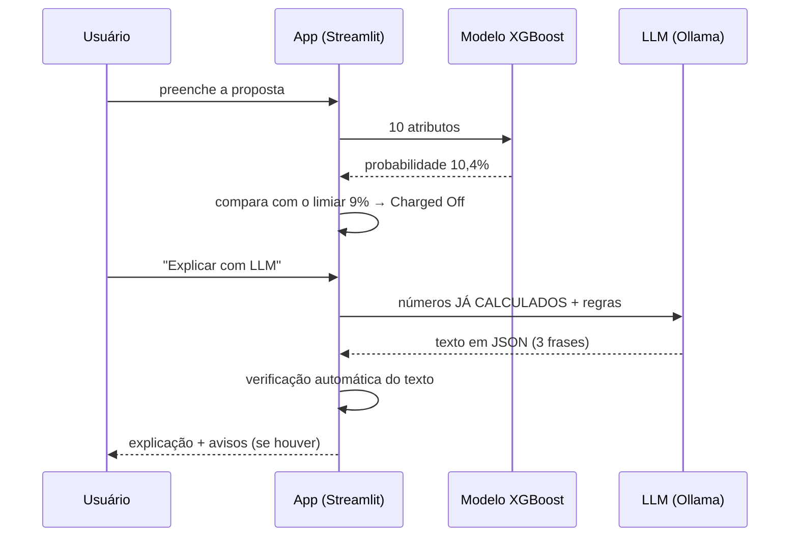

A LLM recebe a probabilidade, o limiar e a classe **prontos** e só redige o texto. Os
números exibidos na tela vêm **sempre** do classificador. Se o Ollama estiver
desligado, o app continua funcionando e só avisa que a explicação está indisponível.

### 10.4 Engenharia de prompt

**Prompt** é o texto de instrução enviado à LLM. Usamos quatro técnicas:

| Técnica | O que é | Como usamos |
|---|---|---|
| **Prompt de sistema** | Regras gerais que valem para toda resposta | "Use só os números fornecidos", "não diga que um dado causou o risco", "não recomende aprovar ou recusar" |
| **Few-shot** (exemplos) | Mostrar exemplos de respostas boas | Dois exemplos com números **diferentes** dos reais e atributos de propósito diferentes, para dar para perceber se a LLM copia o exemplo |
| **Saída estruturada** | Obrigar a resposta a seguir um formato | A LLM devolve um JSON com 3 campos (probabilidade, limiar, atributos), e o código monta o parágrafo |
| **Temperatura baixa** | Controla a aleatoriedade (0 = previsível) | 0,1, com semente fixa (42) |

Também tiramos da LLM a única "conta" que ela fazia: o prompt já diz "10,9% está **acima**
do limiar de 9,0%". Na versão 4, o modelo errou exatamente essa comparação.

### 10.5 Verificação automática e segunda tentativa

Depois da resposta, `check_consistency` procura problemas:

- a probabilidade ou o limiar não foram citados;
- apareceu uma porcentagem que não estava no prompt (número inventado);
- a classe ficou invertida ("abaixo do limiar" quando está acima);
- o texto foi cortado no meio;
- há atribuição de causa ("aumentou o risco", "devido a…");
- há termos absolutos ("sem risco", "certamente").

Se houver erro factual, o sistema gera uma **segunda resposta** (temperatura 0,4) e fica
com a que tiver menos avisos. Os avisos que sobrarem aparecem na tela.

### 10.6 O que aprendemos (v1 a v5)

| Versão | Estratégia | O que aconteceu |
|---|---|---|
| v1 | Texto livre, "até 120 palavras" | Cerca de 200 palavras, listas, texto cortado e uma interpretação errada |
| v2 | "Exatamente 3 frases" | O modelo ignorou: ~150 palavras e 3 de 4 textos cortados |
| v3 | Saída em JSON | Tamanho resolvido, mas omitiu o limiar e inventou uma causa |
| v4 | + exemplos | Errou a comparação "10,9% está abaixo de 9,0%" |
| **v5** | + comparação pronta + segunda tentativa | 4 de 4 perfis corretos, sem avisos |

**Lição:** modelos pequenos seguem mal instruções abertas. A confiabilidade veio de
**restringir o formato**, e não de pedir com mais educação. O preço é um texto menos
fluente, quase um "preencher lacunas guiado".

**No código:** `src/llm.py` e `src/llm_demo.py`. Evidências em
`reports/llm_demonstracao*.md`.

---

## Parte 11 — Testes automatizados

Testes automatizados são pequenos programas que conferem se o sistema faz o que
deveria. São **78 testes**, rodados com:

```bash
.venv/bin/python -m unittest discover -s tests
```

| Arquivo | Testes | O que confere |
|---|---:|---|
| `test_data.py` | 18 | Leitura, limpeza, datas, ausência de vazamento, filtro de maturidade, amostragem, divisão temporal |
| `test_llm.py` | 21 | Prompt, erros do Ollama, verificação de consistência, segunda tentativa |
| `test_basics.py` | 9 | Configuração, métricas, escolha do limiar, calibração, referências e subgrupos |
| `test_inference.py` | 9 | Carregar artefatos, validar entradas, formatação em português |
| `test_pos_teste.py` | 9 | Sensibilidade do limiar e variante v2 |
| `test_training_integration.py` | 8 | Treino de ponta a ponta, pré-processamento ajustado só no treino |
| `test_app.py` | 4 | A interface de verdade, simulando cliques (AppTest do Streamlit) |

Três ideias importantes:

- **Dados sintéticos:** os testes usam dados **inventados e identificados como tais**
  (`tests/sintetico.py`), gerados em pastas temporárias. Eles servem para testar o
  código, **nunca** como resultado. Assim os testes rodam em segundos, sem o arquivo de
  1,68 GB.
- **Mocks:** nos testes, o Ollama é substituído por um "dublê" que devolve respostas
  prontas. Isso permite testar o caso de sucesso e também falhas (Ollama desligado,
  modelo não baixado, demora) sem depender da LLM real.
- **AppTest:** roda o `app.py` sem navegador, preenche o formulário, clica nos botões e
  confere o que apareceu na tela.

---

## Parte 12 — Ambiente e reprodutibilidade

| Ferramenta | Para que serve |
|---|---|
| **uv** | Instala o Python 3.12 e os pacotes, rápido e sem mexer no Python do sistema |
| **venv** (`.venv/`) | Ambiente virtual: uma "caixa" com os pacotes do projeto, separada do sistema |
| `requirements.txt` | Faixas de versão compatíveis |
| `requirements-lock.txt` | Versões **exatas** testadas (pandas 2.3.3, scikit-learn 1.9.1, xgboost 3.4.1, streamlit 1.67.0…) |
| **Git / GitHub** | Histórico de cada mudança; repositório em https://github.com/luaniban/lendingrisk-ai |
| `.gitignore` | Garante que o dataset (1,68 GB) e os modelos `.joblib` **não** sejam enviados |

Para rodar tudo do zero, sigam o `README.md` (instalação, download do dataset, treino e
app).

---

## Parte 13 — Mapa do código

| Arquivo | Responsabilidade |
|---|---|
| `src/config.py` | Atributos, alvo, caminhos, rótulos em português, endereço do Ollama |
| `src/download.py` | Baixa o dataset e confere o SHA-256 |
| `src/audit.py` | Auditoria do arquivo inteiro (status, ausentes, viés de maturidade), sem treinar |
| `src/data.py` | Leitura em blocos, limpeza, filtro de maturidade, divisão temporal |
| `src/training.py` | Pré-processamento, 3 modelos, seleção, limiar, teste, importância, artefatos |
| `src/evaluation.py` | Todas as métricas e tabelas de avaliação |
| `src/figures.py` | Gráficos PNG (cada um com um CSV correspondente) |
| `src/inference.py` | Usado pelo app: carrega e valida artefatos, valida entradas, formata em pt-BR |
| `src/llm.py` | Prompt, chamada ao Ollama, verificação e segunda tentativa |
| `src/llm_demo.py` | Demonstração documentada da LLM com 4 perfis hipotéticos |
| `src/pos_teste.py` | Análises pós-teste (limiar e v1 × v2) |
| `app.py` | Interface Streamlit |
| `tests/` | Testes automatizados |
| `docs/experimentos.md` | Registro científico: protocolo, auditoria, resultados e análises |

**O caminho de uma previsão**, do clique até o número:

1. `app.py` lê os 10 campos do formulário;
2. `inference.validate_record` confere os valores e gera avisos;
3. `inference.predict_probability` monta uma tabela de 1 linha e chama o Pipeline
   carregado de `models/modelo_risco.joblib`;
4. o Pipeline imputa, padroniza, faz o one-hot e passa ao XGBoost, que devolve a
   probabilidade;
5. o app compara com o limiar (`reports/metricas.json`) e desenha o parecer;
6. se o usuário pedir, `llm.explain_checked` gera e verifica a explicação.

---

## Parte 14 — Preparação para a apresentação

### 14.1 O projeto em um minuto

> Usamos 673 mil empréstimos reais do Lending Club para estimar a probabilidade de um
> empréstimo terminar em perda. Corrigimos um viés que inflava a inadimplência nas
> safras recentes, dividimos os dados por tempo e comparamos regressão logística,
> Random Forest e XGBoost. O XGBoost foi escolhido pela Average Precision na validação
> e, no teste, ficou 1,6 vez acima do acaso, com probabilidades bem calibradas. O
> desempenho é modesto, porque só temos 10 informações do pedido. Uma LLM local explica
> o resultado em português, mas não calcula nada: os números vêm sempre do modelo, e
> uma verificação automática confere o texto.

### 14.2 Perguntas prováveis da banca

**Por que não usaram acurácia?**
Porque 85% dos empréstimos são quitados. Um modelo que diz sempre "quitado" teria 85% de
acurácia sem detectar nenhum calote. Usamos AP, recall, precision e calibração.

**Por que a acurácia do modelo é só 38,6%?**
Porque o limiar foi escolhido para priorizar o recall (F2). O modelo sinaliza muita
gente para não deixar passar maus pagadores. Mostramos o efeito de outros limiares na
análise de sensibilidade.

**O que é o filtro de maturidade e por que ele é necessário?**
Nas safras recentes, só os empréstimos que terminaram cedo já tinham desfecho, e entre
eles a taxa de calote era artificialmente alta (25,1% contra 14,8%). O filtro mantém só
os empréstimos cujo prazo já tinha acabado.

**Por que dividir por tempo e não sortear?**
Porque na prática o modelo aprende com o passado e prevê o futuro. Sortear misturaria
os períodos e deixaria o resultado otimista.

**O teste não foi "olhado" antes?**
Não. O protocolo foi versionado antes do treino, e o teste foi calculado uma vez. Tudo
o que fizemos depois está separado e marcado como pós-teste.

**Por que o XGBoost?**
Teve a maior AP na validação, o critério definido antes. A diferença para os outros foi
pequena, o que indica que o limite está nos dados, e não no algoritmo.

**O que significa ROC-AUC de 0,66?**
Em 66% das comparações entre um mau e um bom pagador sorteados, o modelo dá o score
maior ao mau pagador. É melhor que o acaso (50%), mas modesto.

**A probabilidade é confiável?**
Em média, sim. O ECE é de 0,0155, ou seja, cerca de 1,5 ponto percentual de erro. Mas é
uma estimativa para o padrão de 2007–2015, não uma garantia.

**A LLM pode inventar números?**
Pode, por isso ela não calcula nada. Ela recebe os números prontos, o código confere se
o texto cita os valores certos e a classe certa e, se houver erro, gera de novo. Os
números exibidos vêm sempre do modelo.

**Por que uma LLM local e não o ChatGPT?**
Privacidade (dados de crédito não saem da máquina), custo zero e funcionamento offline.

**Qual atributo é mais importante?**
Na média, o score FICO, seguido de renda e consultas de crédito. Mas é importância
global: não explica um caso individual e não indica causa.

**O modelo é justo?**
Fizemos só uma análise descritiva: quem paga aluguel tem 82% dos bons pagadores
barrados, contra 59% de quem tem financiamento. Não aplicamos métricas formais de
justiça, e isso é uma limitação.

**Por que não usaram `grade` e `int_rate`?**
São a avaliação do próprio Lending Club. Com elas, o modelo copiaria essa avaliação em
vez de estimar o risco pelos dados do cliente.

**O que vocês melhorariam?**
Busca de hiperparâmetros, tratar "não informado" como categoria (a v2 já indicou ganho),
avaliar empréstimos de 60 meses com dados mais novos, métricas formais de justiça e
recalibração.

### 14.3 Experimentos para fazer no app

Abram o app e reproduzam estes casos. Os resultados abaixo foram obtidos com o modelo
oficial.

| Caso | O que mudar em relação aos valores iniciais | Resultado |
|---|---|---|
| Perfil mediano | nada (só clicar em "Estimar risco") | 10,4% → Charged Off (logo acima do limiar de 9%) |
| Perfil forte | FICO 780, DTI 8, renda 150.000 | 1,7% → Fully Paid |
| Perfil fraco | FICO 660, DTI 35, rotativo 95, consultas 4 | 34,3% → Charged Off |

Depois testem por conta própria:

- mudem **um campo por vez** e vejam como a régua se move;
- escolham prazo de **60 meses** e leiam o aviso que aparece (Parte 2.4);
- digitem uma renda muito alta (por exemplo, 5.000.000) e vejam o aviso de valor fora
  da faixa;
- peçam a **explicação da LLM** e confiram se os números batem com o parecer.

---

## Glossário

| Termo | Significado |
|---|---|
| **Alucinação** | Quando uma LLM escreve algo convincente, mas falso |
| **Alvo (*target*)** | O que o modelo tenta prever; aqui, Charged Off (1) ou Fully Paid (0) |
| **Atributo (*feature*)** | Cada informação de entrada do modelo |
| **Average Precision (AP)** | Resumo da curva precisão × recall; o acaso vale a proporção de positivos (0,148) |
| **Bernoulli (amostragem)** | Sorteio independente de cada linha com a mesma probabilidade |
| **Brier score** | Erro quadrático médio da probabilidade; menor é melhor |
| **Calibração** | Quanto a probabilidade prevista corresponde à frequência real |
| **Charged Off** | Empréstimo baixado como perda |
| **Classe positiva** | O evento que se quer detectar (aqui, Charged Off); não quer dizer "bom" |
| **DTI** | Dívidas mensais ÷ renda mensal, em % |
| **ECE** | Erro médio de calibração, por grupos de score |
| **F1 / F2 / F-beta** | Combinações de precision e recall; o F2 pesa mais o recall |
| **Falso negativo (FN)** | Mau pagador classificado como bom |
| **Falso positivo (FP)** | Bom pagador classificado como mau (alarme falso) |
| **FICO** | Score de crédito americano, de 300 a 850 |
| **Few-shot** | Dar exemplos de resposta dentro do prompt |
| **Filtro de maturidade** | Manter só empréstimos cujo prazo já terminou |
| **Gradient boosting** | Árvores treinadas em sequência, cada uma corrigindo os erros das anteriores (XGBoost) |
| **Hiperparâmetro** | Configuração escolhida antes do treino (por exemplo, número de árvores) |
| **Imputação** | Preencher valores ausentes (mediana, moda ou categoria própria) |
| **Joblib / pickle** | Formato para salvar o modelo; carregar executa código, por isso só de fontes confiáveis |
| **Limiar (*threshold*)** | Corte que transforma a probabilidade em classe (9%) |
| **LLM** | Modelo de linguagem grande, que gera texto prevendo o próximo token |
| **Log loss** | Métrica de probabilidade que pune muito erros cometidos com confiança |
| **Matriz de confusão** | Tabela real × previsto com VP, FP, FN e VN |
| **Mock** | Dublê de um componente nos testes (por exemplo, um Ollama falso) |
| **Ollama** | Programa que roda LLMs localmente |
| **One-hot encoding** | Transformar uma categoria em colunas 0/1 |
| **Overfitting** | Decorar o treino e ir mal em dados novos |
| **Padronização** | Colocar números na mesma escala (média 0, desvio 1) |
| **Pipeline** | Encadeamento de pré-processamento e modelo, ajustado só no treino |
| **Precision** | Dos sinalizados, quantos eram mesmo Charged Off |
| **Prompt / prompt de sistema** | Instrução enviada à LLM / regras gerais que valem para toda resposta |
| **Pós-teste** | Análise feita depois de usar o teste; é descritiva e não substitui o resultado oficial |
| **Quantização** | Comprimir os pesos de um modelo (por exemplo, para 4 bits) para rodar com menos memória |
| **Random Forest** | Muitas árvores independentes cuja previsão é a média |
| **Recall** | Dos Charged Off reais, quantos foram encontrados |
| **Regressão logística** | Soma ponderada dos atributos passada pela sigmoide |
| **ROC-AUC** | Chance de um positivo sorteado ter score maior que um negativo sorteado |
| **Saída estruturada** | Obrigar a LLM a responder num formato fixo (JSON) |
| **Semente (*seed*)** | Número que torna os sorteios repetíveis |
| **SHA-256** | "Impressão digital" de um arquivo |
| **Streamlit** | Biblioteca que transforma scripts Python em páginas web |
| **Temperatura** | Grau de aleatoriedade da LLM; baixa = previsível |
| **Token** | Pedaço de palavra que a LLM processa |
| **Treino / validação / teste** | Estudar / simulado / prova final |
| **Vazamento de dados** | Usar informação que não existiria no momento real da previsão |
| **XGBoost** | Biblioteca de gradient boosting, o modelo escolhido |
